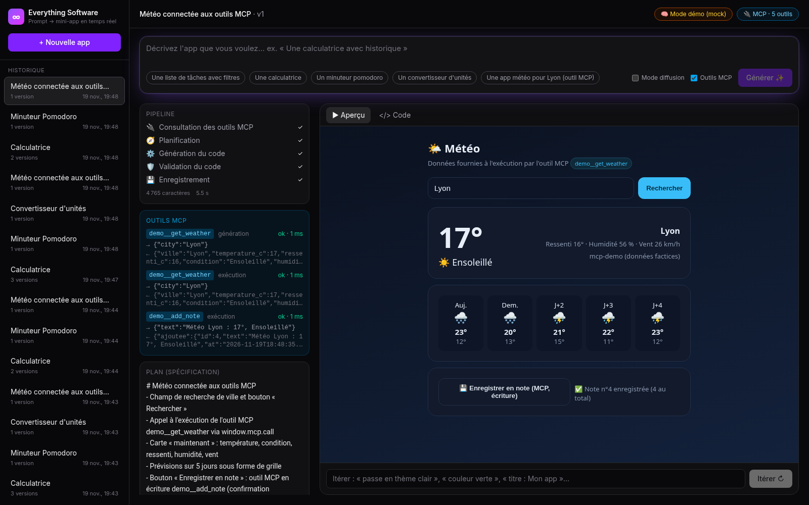
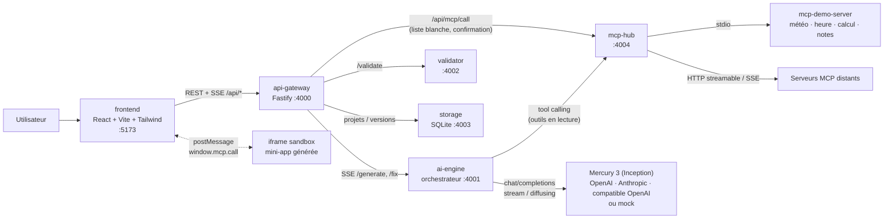
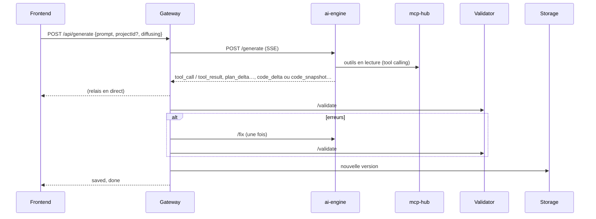
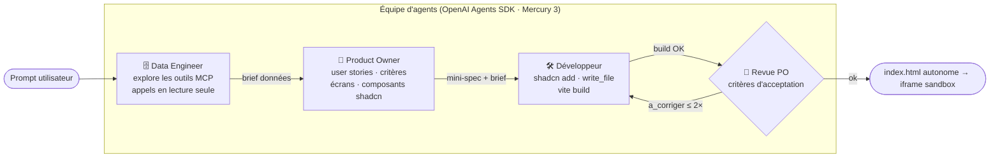

# ✨ Everything Software

> Tapez un prompt, regardez **votre mini-SaaS personnel** (monitoring · simulation · action) se construire **en temps réel**, pilotez-le comme une console de DJ avec son agent contremaître (texte ou voix), et faites-le évoluer en lui parlant.

Plateforme en **micro-services** pilotée par un **moteur d'IA** : le modèle par défaut est **Mercury 3** d'Inception Labs, un LLM de **diffusion** (le texte est « débruité » progressivement, affichable en direct). Les mini-apps peuvent utiliser des **outils MCP**, pendant la génération comme à l'exécution.



## Fonctionnalités

- **Prompt → plan → code streamé → validation → aperçu interactif** (iframe `srcdoc` sandboxée, sans `allow-same-origin`).
- **Mode diffusion** (Mercury) : affichage des étapes de débruitage du code (`diffusing: true`). Si la diffusion s'arrête avant la fin, le moteur relance automatiquement en streaming classique.
- **Itération** : « passe en thème clair », « ajoute un export CSV »… Le code précédent et la consigne sont envoyés au modèle, et chaque résultat devient une nouvelle version.
- **Onglet Code** : lecture et édition, ▶ *Exécuter* sans sauvegarder, 💾 *Enregistrer une version* (validée).
- **Historique** : projets, prompts et versions dans SQLite, avec réouverture et retour à une version antérieure.
- **Validator** : HTML complet, analyse syntaxique de chaque `<script>` (JS, module, JSX/Babel), règles de sécurité. En cas d'erreur, **une** correction automatique est demandée au moteur IA.
- **MCP** :
  - micro-service `mcp-hub` (stdio, HTTP streamable, SSE) configuré par `mcp.config.json` et par l'UI (🔌 MCP) ;
  - **à la génération**, les outils en lecture sont exposés au modèle par *tool calling* ;
  - **à l'exécution**, les mini-apps appellent `await window.mcp.call('demo__get_weather', { city: 'Lyon' })` via un pont sécurisé `postMessage → gateway → mcp-hub`, avec liste blanche d'outils et **confirmation de l'utilisateur** pour les outils en écriture.
- **Mode démo sans clé** : provider `mock` avec des mini-apps réalistes (todo, calculatrice, pomodoro, convertisseur, météo MCP, app générique), streamées token par token, diffusion simulée et itérations simulées.

## Architecture



Pipeline d'une génération (événements SSE relayés au frontend) :



| Service | Dossier | Port | Rôle |
|---|---|---|---|
| frontend | `frontend/` | 5173 (dev) / 8080 (Docker) | Interface React |
| api-gateway | `services/api-gateway/` | 4000 | Point d'entrée unique, SSE, proxy, pont MCP |
| ai-engine | `services/ai-engine/` | 4001 | Providers LLM, plan, génération, correction, tool calling |
| validator | `services/validator/` | 4002 | Analyse syntaxique et sécurité |
| storage | `services/storage/` | 4003 | SQLite (`node:sqlite`, sans dépendance native) |
| mcp-hub | `services/mcp-hub/` | 4004 | Connexions MCP, politique d'accès |
| app-agents | `services/ai-engine/src/app-agents/` | 4005 | Backends MCP des apps + sous-agents contremaîtres (Agents SDK) |
| voice-gateway | `services/voice-gateway/` | 4006 | Voix Google : TTS Gemini, STT Gemini Live (WebSocket), barge-in |
| mcp-demo-server | `packages/mcp-demo-server/` | stdio (ou 4010 en `--http`) | Outils de démo sans clé |

Chaque service a son `package.json`, son `Dockerfile` et un endpoint `GET /health`. `GET :4000/health` agrège l'état de tous les services.

## 🤖 Équipe d'agents (mode par défaut)

Derrière chaque génération, une **équipe de trois agents** construite avec le **[OpenAI Agents SDK](https://github.com/openai/openai-agents-js)** (`@openai/agents`) et branchée sur Mercury 3 :



| Rôle | Entrée | Outils | Sortie |
|---|---|---|---|
| **Data Engineer** | prompt + liste des outils MCP | `mcp_list_tools`, `mcp_sample` (lecture seule, ≤ 8 appels) | *brief données* : sources, schéma (champs, types, exemples), volumes, relations, contraintes, recommandations `window.mcp.call(...)`. Si aucun MCP n'est pertinent : une ligne, et la chaîne continue. |
| **Product Owner** | prompt + brief | — | mini-spec : user stories, critères d'acceptation, écrans, composants shadcn |
| **Développeur** | spec + brief | `shadcn_add` (vraie CLI `npx shadcn add`), `write_file`, `read_file`, `list_files`, `build` (`vite build`), MCP lecture seule | app React + Tailwind + shadcn compilée en un seul `index.html` |
| **Revue PO** | spec + fichiers + résultat du build | — | verdict JSON `ok` / `a_corriger` (au plus 2 renvois au Dev) |

Chaque étape (appel d'outil, commande CLI, fichier écrit, build, brief, spec, revue) est **streamée en direct** dans le panneau « Agent » du studio (onglets Agent / Pipeline). L'interrupteur **« Équipe d'agents »** permet de repasser en génération directe (un seul appel LLM).

### Pourquoi l'OpenAI Agents SDK ?
- **Compatible OpenAI nativement** : Mercury 3 expose une API compatible OpenAI → `OpenAIChatCompletionsModel` suffit, sans adaptateur.
- **Léger et explicite** : `Agent` + `tool()` (schémas zod) + `run()` en streaming ; l'orchestration DE → PO → Dev ↔ revue reste du TypeScript lisible (`services/ai-engine/src/agent/crew.ts`), facile à déboguer.
- **Remplaçable** : LangGraph.js apporte un graphe d'états plus lourd dont on n'a pas besoin pour une chaîne linéaire avec boucle bornée ; Mastra impose davantage son runtime. Le SDK reste interchangeable (seul `crew.ts` en dépend).

### Workspace isolé par app
- Template **Vite + React + Tailwind v4 déjà passé par `shadcn init`** (`bash scripts/setup-agent-template.sh` → `data/agent-template`).
- Chaque génération copie le template dans `data/workspaces/ws-…` (`node_modules` lié en dur, sources copiées) ; les 20 plus récents sont conservés.
- `vite build` + `vite-plugin-singlefile` → un `index.html` autonome (250–550 Ko) affiché dans l'iframe sandbox.

### Sécurité de l'agent
- Aucune commande shell libre : uniquement `shadcn add <composants de la liste blanche>` et `vite build`, lancés via `execFile` (sans shell), une à la fois par workspace, avec délai maximal et environnement nettoyé (aucune clé transmise).
- Écriture limitée à `src/**` et `index.html` ; chemins `..`, absolus ou `node_modules` refusés.
- MCP en **lecture seule** pour les agents (outils d'écriture refusés), sorties tronquées, chemins du serveur masqués dans les messages d'erreur.
- Repli hors ligne : si le registre shadcn est injoignable, copie locale des mêmes composants.

### Mode démo sans clé
Sans clé LLM, une **équipe scriptée** joue les trois rôles avec les **vrais outils** (vraie CLI shadcn, vrai `vite build`, vrais appels MCP). Ajoutez `[revue]` au prompt pour voir le PO renvoyer une première version au Dev.

### Temps observés (Mercury 3, mode agent)
24,7 s · 25,6 s · 27,9 s · 34,9 s · 76,1 s (ce dernier avec une reprise demandée par la revue PO et 3 builds) → **≈ 38 s en moyenne, ≈ 28 s en médiane**. Mode démo scripté : ≈ 8 s. Mesure : `node scripts/gen-time.mjs "<prompt>"`.

## 🎛️ Mini-SaaS personnels : monitoring, simulation, action

Chaque app générée est un **mini-SaaS personnel**, mono-utilisateur, sans compte ni partage, ouvert directement sur **tes** données. Ses données et son historique restent en local (SQLite du backend de l'app). Une app fait trois choses :
- **Surveiller** : graphiques shadcn Charts rafraîchis en continu, seuils et anomalies ;
- **Simuler** : des knobs (Slider) qui recalculent instantanément les scénarios « et si » ;
- **Agir** : des pads, avec confirmation explicite et un journal pour tout effet réel.

On ne saisit pas de données : elles arrivent des sources MCP ou des fichiers importés.

**Mindset DJ.** L'app se pilote comme une console :
- les sources de données sont des decks, comparés avec un crossfader (réel ou scénario) ;
- les knobs règlent la simulation, les VU-mètres montrent le live ;
- les scènes sont des presets que l'on sauvegarde et rappelle ;
- un co-DJ suggère le prochain mouvement.

**Mise en page** : un dashboard à gauche et un chat agentique à droite (`AppShell`, `src/components/es/app-shell.tsx`).

### Une app = 3 parties cohérentes
1. **Front** React + shadcn/ui, compilé en un seul `index.html`.
2. **Backend MCP propre à l'app** : agrégation, simulation et stockage local de l'historique, des scènes, des réglages et du journal. Le contrat est écrit par le PO et l'implémentation par le Dev (`server/tools.ts`), puis testée (`test_backend`).
3. **Sous-agent « contremaître »**, construit avec l'OpenAI Agents SDK et Mercury 3 (service `app-agents`, :4005). Il agit avec :
   - les outils de l'app ;
   - les outils MCP externes autorisés, avec du retrieval (`mcp_list_tools`, `mcp_read_resource`, `mcp_call`) ;
   - la mémoire ;
   - un plan de tâches.

### Le contremaître : ordres de données et évolution de l'app
Dans le chat de l'app, le contremaître décide lui-même du traitement de chaque message :
- **Ordre sur les données** (« pourquoi les ventes baissent ? », « simule +5 % ») : il appelle les outils MCP et répond.
- **Évolution de l'app** (« ajoute un graphique par produit ») : il appelle `evolve_app`. L'équipe Data Engineer → PO → Dev reconstruit l'app, puis une nouvelle version est enregistrée. Le CLI de l'app (`app_cli`) est fusionné avec cette itération.

Il n'y a **pas de barre d'itération séparée** : tout passe par le chat.

### 🗣️ Voix (Google) = outil du contremaître
**Mercury 3 reste le cerveau et ne traite que du texte. Google ne s'occupe que de la voix**, à travers le micro-service `voice-gateway` (:4006).
- **TTS** : Gemini TTS, modèle `gemini-3.8-flash-lite-tts`, voix Charon par défaut. La synthèse se fait phrase par phrase avec préchargement. Mesuré à environ 2,5 s par phrase.
- **STT en streaming** : Gemini Live, modèle `gemini-3.5-transcribe-live` (PCM 16 kHz par WebSocket). Les transcriptions intermédiaires permettent le **barge-in** (on coupe la parole à l'agent). La transcription finale arrive environ 0,6 s après la fin de la phrase.
- **Outils du contremaître** : la voix est exposée comme des outils, `voice.speak(text, style)`, `voice.listen`, `voice.confirm(question)` et `voice.stop`. Une confirmation d'action peut se faire **à la voix ou par clic** : la carte de confirmation reste affichée.
- **Studio** : push-to-talk (bouton 🎙️ ou touche Espace) ou mode mains libres avec le mot d'éveil « Jarvis ». Un orbe dans l'en-tête de l'app indique l'état de la voix.
- **Configuration** : `GOOGLE_API_KEY` dans `.env`, qui n'est jamais commité ni affiché. `VOICE_MOCK=1` active une voix simulée pour les tests. Test réel : `npm run voice:smoke`.
- **Proxy** : `/voice` est relayé vers :4006 par Vite (dev et preview) et par nginx (Docker). Le `voice-gateway` doit donc tourner.

### 🎚️ Composants d'action contrôlés par le contremaître
Les apps peuvent avoir des boutons et des champs, mais c'est **le contremaître qui les contrôle**, avec trois outils : `ui_render_action`, `ui_update_action` et `ui_remove_action`. Ils lui servent à afficher, masquer, préremplir ou activer un composant.
- Chaque geste de l'utilisateur lui revient sous forme de message (`⚡ libellé · événement : valeur`).
- Tout effet réel passe par lui, avec une confirmation.

Le registre (`src/components/es/actions.tsx`) reprend les noms de l'Apps SDK UI, mais les composants sont des **équivalents shadcn** préinstallés par la CLI :

Alert, Avatar, AvatarGroup, Badge, Button, ButtonLink, Checkbox, CodeBlock, DatePicker, DateRangePicker, EmptyMessage, Indicators, Input, Markdown, Menu, Popover, RadioGroup, SegmentedControl, Select, SelectControl, Slider, Switch, TagInput, TextLink, Textarea, CopyTooltip, Tooltip.

### ✨ Scènes vivantes : PixiJS v8 (2D) et three.js (3D)
Le contremaître a trois outils pour les scènes : `ui_render_scene(kind, scene, data, params, id)`, `ui_update_scene` et `ui_remove_scene`.
- **Catalogue (Pixi)** : particle-flow, agent-sim, live-heatmap, network-graph.
- **Catalogue (three)** : 3d-bars, 3d-surface, 3d-concept-model.
- **Pas limité au catalogue** : toute métaphore demandée (« visualise mon tunnel de conversion comme une machine ») devient une **scène sur mesure** générée par le Dev via `evolve_app`.
  - Interface standard : `CustomScene = (lib, ctx, spec) => ({ update, destroy })` avec `spec = { data, params }` et `ctx.onEvent`.
  - On l'enregistre avec `registerScene(nom, 'pixi' | 'three', factory)`.
  - Les données sont liées au MCP et les paramètres de simulation sont relus à chaque frame. Le renderer est libéré dans `destroy`.
  - Le catalogue et l'exemple `scene-examples/conversion-machine.ts` servent de few-shot dans le prompt du Dev. Cet exemple montre des tapis et des engrenages dont la vitesse suit le débit, des visiteurs-particules qui tombent selon le taux de chute, et un goulot qui rougit et fume.
- **Chargement léger** : Pixi et three ne sont **pas** des dépendances npm des apps. Les fichiers `packages/es-runtime/vendor/{pixi,three}.min.js` (environ 1,7 Mo au total) sont chargés à la demande depuis `/runtime/` (gateway ou nginx, cache immuable). Le bundle d'une app ne grossit pas.
- **Démo** : la console de ventes affiche une machine du tunnel de conversion (outil MCP de démo `get_funnel`), liée aux knobs prix et trafic. Dans le chat, essayez « visualise mon tunnel de conversion comme une machine », « montre-moi les flux en mouvement » ou « affiche les contrôles ».

### Captures « mini-SaaS vivants »
- `screenshots/42-mercury-console-generee.png` : console de ventes générée par Mercury 3 (174 s, revue PO ok à la 2e itération), avec une scène machine sur mesure enregistrée par le Dev.
- `screenshots/43-mercury-contremaitre-scene-curseur.png` : ordre au contremaître Mercury, « montre le tunnel en machine et donne-moi un curseur pour simuler plus de trafic ». En 3,6 s, il appelle `render_scene` puis `render_action` (Slider).
- `screenshots/44-scene-machine-pixi.png`, `45-composants-action.png` et `46-scenes-catalogue.png` : la machine du tunnel de conversion (PixiJS), les composants d'action shadcn et le catalogue de scènes.

### Espace disque (template des apps)
`data/agent-template/node_modules` pèse environ 293 Mo :
- environ +39 Mo pour les composants d'action (date-fns, cmdk et react-day-picker via shadcn ; react-markdown et typography) ;
- environ 1,7 Mo de fichiers vendor pour Pixi et three.

Après une mise à jour, relancez `bash scripts/setup-agent-template.sh` (registre shadcn, nécessite le réseau) ou `npm install` dans `data/agent-template`.

## 🎨 shadcn/ui partout
Le studio et les apps générées utilisent **shadcn/ui** (style radix-nova, thème sombre violet). En mode direct, les apps importent les composants depuis le runtime partagé `packages/es-runtime` (servi par la gateway sur `/runtime/`) ; en mode agent, elles sont compilées avec leurs propres composants ajoutés par la CLI.

## 🌐 Mode public (protégé par mot de passe)
```bash
bash scripts/start-public.sh            # build + services (supervisés) + tunnel cloudflared
bash scripts/start-public.sh --no-tunnel
bash scripts/start-public.sh --rebuild  # rebuild forcé
bash scripts/start-public.sh --stop
```
- Point d'entrée unique : la gateway (`:4000`) sert le studio buildé et l'API, protégée par **Basic Auth** (identifiants dans `.access`, `chmod 600`, format `user:motdepasse`, jamais commité).
- Tunnel : cloudflared (Quick Tunnel), puis repli localhost.run. **Le tunnel nécessite une sortie réseau sur le port 7844 (ou SSH 22)** : dans un réseau qui ne laisse passer que HTTP(S) via proxy, l'URL `trycloudflare.com` est attribuée mais répond 530. Dans ce cas, lancez le script sur une machine avec un accès réseau normal, ou déployez sur un hébergeur (VPS, Render, Fly.io…).
- Après une réinitialisation de la machine : `npm install && bash scripts/setup-agent-template.sh && bash scripts/start-public.sh --rebuild`.

## 📸 Captures
| | |
|---|---|
| Studio shadcn | `screenshots/14-studio-shadcn-accueil.png` |
| Agent en cours / terminé (démo) | `screenshots/14-agent-en-cours.png`, `screenshots/14-agent-termine.png` |
| Brief Data Engineer (démo) | `screenshots/14-brief-data-engineer.png` |
| App shadcn générée / code (démo) | `screenshots/14-app-shadcn.png`, `screenshots/14-code-source.png` |
| Mercury 3 réel | `screenshots/15-mercury3-*.png` (agent en cours, terminé, brief, app, code) |

## Démarrage

Prérequis : **Node.js ≥ 22.13** (24 recommandé, pour `node:sqlite`).

```bash
cp .env.example .env          # sans clé : repli automatique sur le mock
npm install
npm run dev                   # lance les 6 processus avec concurrently
# → http://localhost:5173
```

Avec Docker (non testé sur la machine de build, Docker n'y étant pas disponible) :

```bash
docker compose up --build     # → http://localhost:8080
```

Tests :

```bash
npm test                      # tests unitaires ai-engine + validator
npm run e2e                   # bout en bout via la gateway (services lancés)
npm run screenshots           # captures Playwright (pip install playwright)
```

## Brancher un vrai LLM

### Mercury 3 (défaut)

1. Créez une clé sur <https://platform.inceptionlabs.ai> (rubrique *API Keys*).
2. Dans `.env` :
   ```env
   LLM_PROVIDER=inception
   INCEPTION_API_KEY=votre_cle
   LLM_MODEL=mercury-3
   LLM_REASONING_EFFORT=instant  # instant | low | medium | high
   ```
3. Redémarrez `npm run dev`. Le badge en haut à droite affiche `mercury-3 · Inception (diffusion)`.

Endpoint utilisé : `POST https://api.inceptionlabs.ai/v1/chat/completions`, compatible OpenAI. Il prend en charge `stream`, `diffusing`, `tools`, `reasoning_effort` et `max_completion_tokens`.

> ⚠️ D'après la documentation d'Inception (consultée le 19/11/2026), **l'API Mercury ferme** : elle reste disponible jusqu'au **28 décembre 2026**. Prévoyez un provider de repli (voir ci-dessous) : il suffit de changer `LLM_PROVIDER`.

### Autres providers

```env
# OpenAI ou tout service compatible (OpenRouter, Groq, Mistral, Ollama…)
LLM_PROVIDER=openai
LLM_API_KEY=...
LLM_MODEL=gpt-4o-mini
LLM_BASE_URL=https://openrouter.ai/api/v1      # optionnel

# Anthropic
LLM_PROVIDER=anthropic
LLM_API_KEY=...
LLM_MODEL=claude-…
```

Sans clé, le moteur bascule sur le **mock**, et `GET /api/config` indique la raison (`fallback`). `LLM_PROVIDER=mock` force le mode démo.

## MCP

### Configuration

`mcp.config.json` (racine) :

```json
{
  "servers": [
    { "id": "demo", "transport": "stdio", "command": "npx", "args": ["tsx", "packages/mcp-demo-server/src/index.ts"],
      "enabled": true, "allowedTools": ["get_weather", "get_time", "calculate", "list_notes", "add_note"], "writeTools": [] },
    { "id": "distant", "transport": "http", "url": "https://exemple.com/mcp", "auth": { "secret": true },
      "enabled": true, "allowedTools": "*" }
  ]
}
```

- `transport` : `stdio` (commande locale), `http` (HTTP streamable) ou `sse` (ancien transport).
- `allowedTools` : la liste blanche. Un outil absent de cette liste n'est **jamais** appelable. Les serveurs ajoutés depuis l'UI démarrent avec une liste vide.
- **Outils en écriture** : un outil est traité comme tel quand son annotation MCP `readOnlyHint` n'est pas `true`, ou quand il figure dans `writeTools`. Ces outils ne sont **jamais** proposés au modèle pendant la génération. À l'exécution, ils demandent une confirmation dans l'UI, puis `mcp-hub` refuse l'appel (HTTP 428) tant que `confirmed: true` n'est pas fourni.
- Le panneau 🔌 MCP de l'UI permet d'activer ou désactiver un serveur, de cocher les outils autorisés, et d'ajouter ou retirer des serveurs. Les changements sont sauvegardés dans `mcp.config.json`.
- **Authentification (serveurs HTTP streamable / SSE)** : champ « Jeton (Bearer) » (et en-têtes personnalisés en mode avancé) dans le formulaire, ou « Ajouter / Remplacer le jeton » sur un serveur existant. Le jeton est envoyé en `Authorization: Bearer …` sur chaque requête (POST, flux GET/SSE, reconnexions). Il est stocké uniquement dans `data/secrets/mcp-servers.json` (chmod 600, dossier chmod 700, ignoré par git ; `MCP_SECRETS_PATH` pour changer) ou dans le `.env` via `MCP_TOKEN_<ID>` (ex. `MCP_TOKEN_N8N`, prioritaire). `mcp.config.json` ne garde que la référence `"auth": { "secret": true }` ; l'API ne renvoie que « jeton enregistré ••••xxxx ». Un 401 affiche : « Le serveur demande une authentification : ajoute un jeton Bearer ». Les anciens `headers` en clair de la config sont migrés automatiquement.
- L'ajout d'un serveur **stdio** depuis l'UI revient à exécuter une commande locale. Il est donc désactivé par défaut (`MCP_ALLOW_UI_STDIO=false`) : éditez plutôt le fichier.

### Pont d'exécution des mini-apps

Le frontend injecte dans l'iframe un petit script qui expose :

```js
const meteo = await window.mcp.call('demo__get_weather', { city: 'Lyon' }); // Promise<résultat JSON>
const outils = await window.mcp.tools();
```

Le parent n'accepte que les messages venant de **son** iframe (`event.source`). Il vérifie la liste blanche et affiche la boîte de confirmation pour les écritures, puis appelle `POST /api/mcp/call`. La gateway limite à 60 appels par minute et à 20 Ko d'arguments. Le hub applique la politique et appelle le serveur MCP.

### Serveur de démo

`packages/mcp-demo-server` : `get_weather` (factice, déterministe), `get_time`, `calculate`, `list_notes`, `add_note` (écriture). Pour tester le transport HTTP : `npm run start:http -w packages/mcp-demo-server`, puis activez « demo-http » dans le panneau MCP.

## Étendre

- **Nouveau provider** : implémenter `LLMProvider` (`services/ai-engine/src/types.ts` : `stream` et `chatWithTools`), puis l'enregistrer dans `providers/index.ts`.
- **Nouvelle app du mock** : ajouter un fichier HTML dans `services/ai-engine/src/mock/apps/` et une entrée (mots-clés et plan) dans `mock/catalog.ts`.
- **Nouvelle règle de sécurité** : ajouter une regex à `FORBIDDEN` ou `SUSPICIOUS` dans `services/validator/src/validate.ts`, avec un test.
- **Prompts système** : `services/ai-engine/src/prompts.ts`.
- **Nouveau micro-service** : dossier `services/<nom>` avec `/health`, une route dans la gateway et une entrée dans `docker-compose.yml`.

## Astuces de démo (mock)

- Itérations reconnues : « thème clair », une couleur (« couleur verte »), « titre : … », « plus grand », « coins arrondis ».
- Ajoutez `[bug]` au prompt pour injecter une erreur JS : le validator la détecte et la correction automatique s'enclenche.

## Limites connues

- **Mercury 3 / API Inception : arrêt annoncé le 28 décembre 2026** → basculer ensuite `LLM_PROVIDER`/`LLM_BASE_URL` vers un autre modèle compatible OpenAI.
- Mode agent plus lent que le mode direct (≈ 30–40 s contre ≈ 10 s) ; le premier `shadcn add` dépend du réseau (repli local sinon).
- Les images Docker (dont le build du template agent) n'ont pas été testées dans cet environnement.
- Le mode public dépend d'une sortie réseau compatible avec le tunnel (voir plus haut).

- Une seule passe de correction automatique, comme spécifié. Avec un vrai LLM, une erreur peut subsister : elle est alors affichée et la version est enregistrée avec son rapport.
- Le validator fait une analyse **statique** (syntaxe et motifs dangereux). Ce n'est pas une analyse d'exécution : la vraie barrière reste l'iframe sandboxée sans `allow-same-origin`, où `localStorage` est indisponible et les apps doivent utiliser `try/catch`.
- Avec Mercury, `diffusing` s'arrête parfois avant la fin sur les longs fichiers (`finish_reason=length`). Le moteur relance alors en streaming classique, ce qui rallonge la génération.
- La confirmation des écritures MCP est portée par le frontend : la gateway fait confiance au drapeau `confirmed`. C'est adapté à un usage local mono-utilisateur ; ajoutez une authentification avant toute exposition réseau.
- Pas d'authentification ni de multi-utilisateur. Le mock n'« invente » pas d'app sur mesure : hors catalogue, il produit une app générique.
